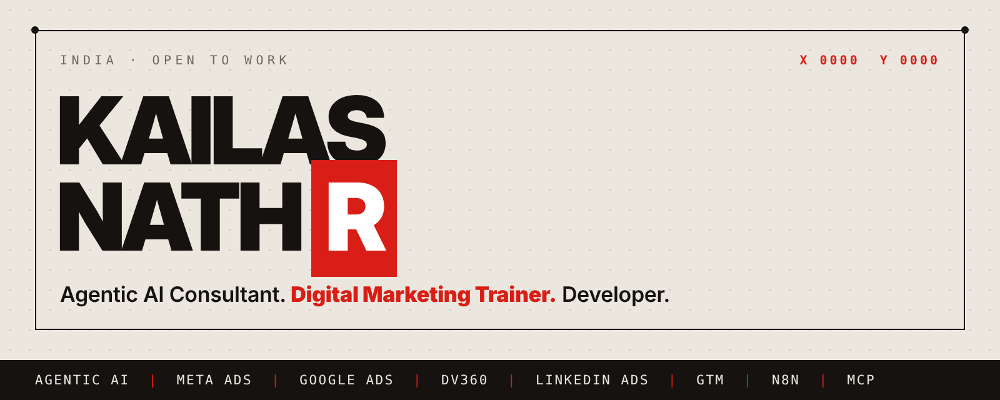
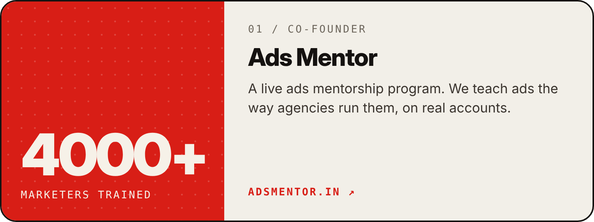
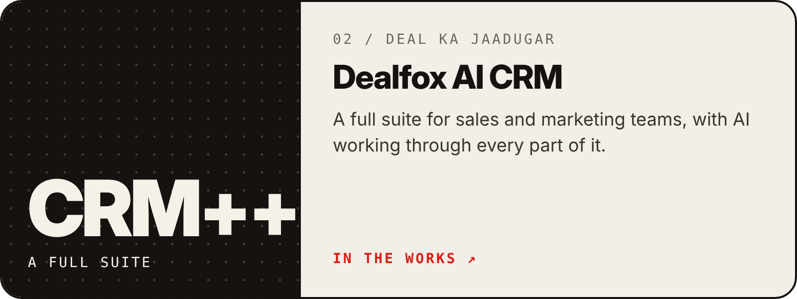
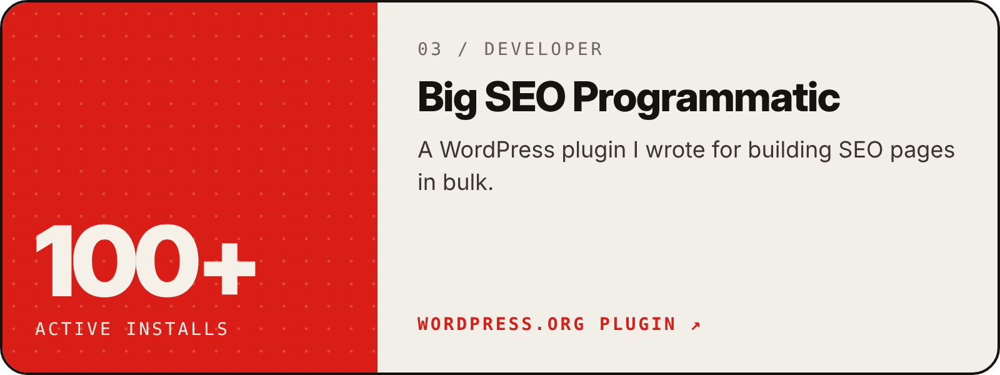
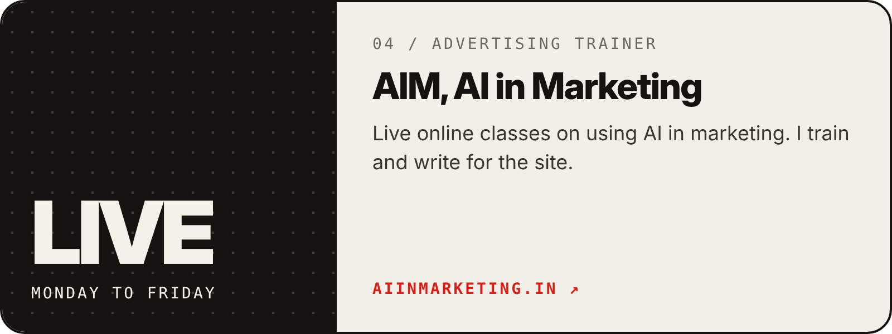
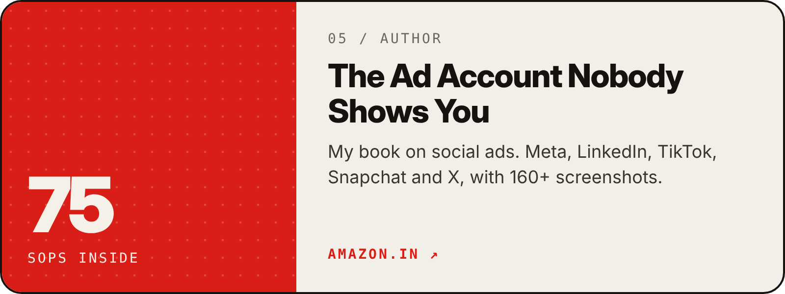
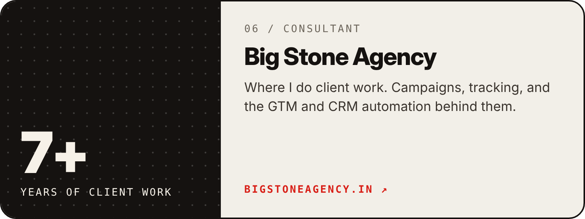
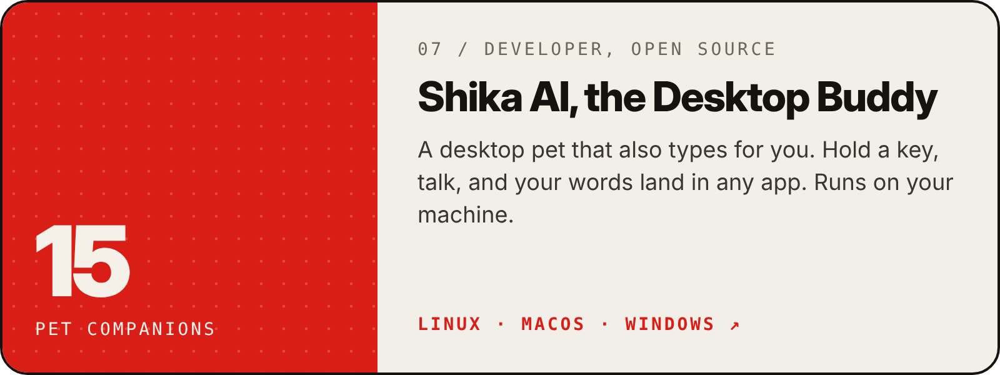

  

I run ads for brands, build AI agents that do the boring parts of marketing, and teach both. When a job gets repetitive, I write code for it. India.

  <a href="https://iamknr.in"><b>Portfolio</b></a> &nbsp;|&nbsp;
  <a href="https://linkedin.com/in/iamknr"><b>LinkedIn</b></a> &nbsp;|&nbsp;
  <a href="https://aiinmarketing.in/author/kailasnathr"><b>Articles</b></a> &nbsp;|&nbsp;
  <a href="https://profiles.wordpress.org/kailasnathr/"><b>WordPress.org</b></a>

## Where you will find my work

<table>
  <tr>
    <td width="50%"></td>
    <td width="50%"></td>
  </tr>
  <tr>
    <td width="50%"></td>
    <td width="50%"></td>
  </tr>
  <tr>
    <td width="50%"></td>
    <td width="50%"></td>
  </tr>
  <tr>
    <td colspan="2"></td>
  </tr>
</table>

## What I work with

Meta Ads, Google Ads, DV360, LinkedIn Ads, Google Tag Manager, GA4, Claude, MCP, n8n, WordPress, TypeScript, PHP, Python.

## Open source

- [Shika AI](https://github.com/iam-knr/desktop-buddy): a desktop pet that types what you say, with local speech and language models. Linux, macOS and Windows.
- [Big SEO Programmatic](https://wordpress.org/plugins/knr-pseo-generator/): a WordPress plugin for bulk SEO pages.

## Hire me

Tell me which marketing job eats your team's week. I build an agent that does it, and I show your team how to keep it running. Start on [LinkedIn](https://linkedin.com/in/iamknr).
